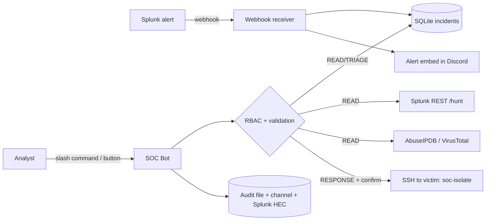

# SOC Automation Bot & Incident Triage Assistant

A Discord ChatOps bot, written in Python, for a fully local SOC lab. Splunk alerts arrive through a webhook into a small SQLite incident store. Analysts triage, enrich, hunt, contain and close incidents from chat. Every action is checked against role-based access control and written to an audit log that is also forwarded to Splunk.

See [docs/architecture.md](docs/architecture.md) for the lab and [docs/bot-refactor-plan.md](docs/bot-refactor-plan.md) for the migration plan.

## Project status

Part of a fully local SOC lab (no cloud): Caldera attack, victim logs, Splunk, then this bot. "Built and tested" means the code has unit tests; it does not yet mean it has run end to end in the lab.

| Area | Status |
|---|---|
| Attacker VM with MITRE Caldera, victim VM with Sandcat agent and auditd | Built; first Discovery run recorded in [attack-scenarios/01-discovery.md](attack-scenarios/01-discovery.md) |
| Bot (webhook, SQLite store, /hunt, SSH isolation, RBAC, audit) | Built and unit-tested; reviewed in [docs/security-review.md](docs/security-review.md); not yet run against a live Splunk or a real isolation |
| SIEM pipeline: Filebeat (victim), Logstash and Splunk in Docker (SIEM VM) | Working end to end: commands typed on the victim are searchable in Splunk within seconds, with the correct time; noise filtered (see [lab build log](docs/lab-build-log.md), sections 7 to 12) |
| Splunk detections mapped to MITRE ATT&CK, webhook alerts | In progress: two detections written, one proven (see `docs/detections.md`); alert and webhook action next |
| Auto-enrichment playbook, dashboard, more attack scenarios | Ideas, after the pipeline works end to end |

New to security? Read the [plain-language overview](docs/plain-language-overview.md) first.

Documentation: [architecture](docs/architecture.md), [lab build log](docs/lab-build-log.md), [troubleshooting](docs/troubleshooting.md), [security review](docs/security-review.md), [bot refactor plan](docs/bot-refactor-plan.md).

## Start here

To rebuild the lab and the bot from scratch, follow the documents in this order:

1. [Background and goal](docs/lab-build-log.md): what the project is and why it runs as a local lab on Splunk instead of Azure.
2. [Before you start](docs/lab-build-log.md): the computer, software and ISO images needed.
3. [Build the VMs](docs/lab-build-log.md): VirtualBox settings, the host-only network, the victim and attacker VMs, and Caldera.
4. [Run the lab day to day](docs/lab-operations.md): start order, SSH, starting Caldera and the agent, snapshots, shutting down.
5. [Run an attack scenario](attack-scenarios/01-discovery.md): the first Caldera operation and the evidence auditd records.
6. [Set up the bot](#setup) in this README, with the [security review](docs/security-review.md) for what was checked.
7. [Roadmap](docs/roadmap.md): the SIEM build and further ideas.


---

## Features

| Area | What it does |
|---|---|
| **Alert intake** | Splunk alert webhook, shared-secret checked and validated, stored in SQLite, posted as an embed with Acknowledge, Enrich and Isolate buttons |
| **Triage** | List, show, comment on and close incidents (`true_positive`, `false_positive`, `benign`) |
| **Hunting** | `/hunt` runs predefined read-only SPL templates through the Splunk REST API. Chat input only fills validated parameters |
| **Enrichment** | IP reputation from AbuseIPDB and VirusTotal. Private IPs are never sent to third parties. A failed lookup yields an `Incomplete` verdict, never `Clean` |
| **Containment** | Isolate or release a host over SSH as a restricted `responder` user that may only run two sudoers-listed scripts |
| **RBAC** | Three role tiers (READ, TRIAGE, RESPONSE) mapped to Discord role IDs, plus a required channel allow-list |
| **Safety rails** | Confirmation buttons only the requester can press, an isolation deny-list, an SSH host allow-list, strict input validation |
| **Audit** | JSON Lines file, optional `#soc-audit` channel feed, and forwarding to Splunk HEC (index `soc_audit`) |
| **Mock mode** | In-memory incidents, Splunk, SSH and threat-intel data for demos |

## Commands

| Command | Tier | Backend |
|---|---|---|
| `/incident list [status] [severity] [limit]` | READ | SQLite store |
| `/incident show <incident>` | READ | SQLite store (details and last comments) |
| `/enrich <ip> [incident]` | READ | AbuseIPDB, VirusTotal; result added as an incident comment if linked |
| `/hunt <template> [window] [target]` | READ | Splunk REST `:8089`, `services/search/jobs/export` |
| `/incident comment <incident> <message>` | TRIAGE | SQLite store |
| `/incident close <incident> <classification> <comment>` | TRIAGE | SQLite store |
| `/isolate <host> <reason> <incident>` | RESPONSE | SSH `sudo soc-isolate` |
| `/unisolate <host> <reason> <incident>` | RESPONSE | SSH `sudo soc-unisolate` |
| `/soc-help` | any | Shows the commands and your tier |

`<incident>` is the incident number shown in the list (for example `12`).

Command-to-backend flowcharts are in [docs/flowchart.md](docs/flowchart.md).



## Project layout

```
soc_bot/
├── __main__.py            # entry point: python -m soc_bot
├── config.py              # env-based settings + validation
├── rbac.py                # Permission tiers and AccessPolicy
├── validators.py          # incident ref / IP / hostname validation, deny-list
├── audit.py               # JSON Lines audit logger
├── models.py              # Incident, Comment, IsolationResult, IpReport
├── hunts.py               # predefined SPL templates and parameter validation
├── webhook.py             # Splunk alert receiver (aiohttp)
├── store/incidents.py     # SQLite incident store
├── clients/
│   ├── base.py            # API error types + readable error extraction
│   ├── splunk.py          # REST search client and HEC audit forwarder
│   ├── ssh_response.py    # asyncssh isolation with a fixed command set
│   ├── enrichment.py      # AbuseIPDB + VirusTotal
│   └── mock.py            # in-memory fakes for demo mode
└── discord_bot/
    ├── bot.py             # SocBot: wiring, webhook server, error handling, audit
    ├── checks.py          # @require(Permission.X) and ensure()
    ├── views.py           # Confirm/Cancel button view
    ├── alerts.py          # persistent Acknowledge/Enrich/Isolate buttons
    ├── embeds.py          # all Discord embed rendering
    └── cogs/              # incidents, enrichment, hunt, response, general
infra/
├── auditd/soc.rules       # victim auditd rule
└── responder/             # soc-isolate, soc-unisolate, soc-gate, sudoers entry, setup README
tests/                     # pytest: commands and buttons, store, webhook, clients, RBAC, validators, config
```

## Setup

### 1. Discord application

1. Go to <https://discord.com/developers/applications>, create a **New Application**, open **Bot**, then **Reset Token**. Copy the token into `DISCORD_TOKEN`.
2. Leave all privileged intents off. The bot doesn't need them.
3. In **OAuth2 → URL Generator**, select the `bot` and `applications.commands` scopes and the *Send Messages* and *Embed Links* permissions. Use the generated URL to invite the bot.
4. Create roles such as `SOC-L1` (READ), `SOC-L2` (TRIAGE) and `SOC-IR` (RESPONSE). Enable *Developer Mode*, then right-click each role and channel to copy its ID.

### 2. Splunk

1. **Search token:** Settings → Tokens → New Token for a user with search rights. Put it in `SPLUNK_TOKEN` and set `SPLUNK_URL=https://<siem>:8089`. For the lab's self-signed certificate, set `SPLUNK_VERIFY_TLS=false`.
2. **Alert webhook:** Splunk must `POST` to `http://<bot-host>:8765/webhook/splunk` with the header `X-Webhook-Secret: <WEBHOOK_SECRET>`. The secret is accepted in that header only, never in the URL. Splunk's built-in **Webhook** alert action cannot add headers, so use a custom alert action that does, or a reverse proxy on the Splunk host that adds the header for Splunk's own requests only. Have the SPL return `host`, `src_ip` and `severity` fields so the bot can fill the incident.
   - The receiver binds to `127.0.0.1` by default. See [Webhook protection](#webhook-protection) before binding it wider.
   - **Alert links:** the `results_link` in the payload is kept only if it is a plain http(s) URL whose hostname is the hostname of `SPLUNK_URL` or is listed in `WEBHOOK_LINK_HOSTS` (comma-separated bare hostnames, no scheme or port). Ports are ignored, so a `SPLUNK_URL` on the management port 8089 also allows links on the web port 8000. If neither setting is set, every link is dropped and the bot logs a warning at startup; the alert is still stored and posted.
3. **Audit forwarding (optional):** create an HEC token allowed to write to index `soc_audit`, then set `SPLUNK_HEC_URL` and `SPLUNK_HEC_TOKEN`.

Test the webhook without Splunk:

```powershell
curl.exe -X POST "http://127.0.0.1:8765/webhook/splunk" -H "X-Webhook-Secret: $env:WEBHOOK_SECRET" -H "Content-Type: application/json" -d '{\"search_name\":\"Test alert\",\"result\":{\"host\":\"soc-victim\",\"src_ip\":\"185.220.101.4\",\"severity\":\"high\"}}'
```

### 3. Victim host (isolation)

Full steps, including the key restriction and a verification checklist, are in [infra/responder/README.md](infra/responder/README.md). In short:

1. Create the `responder` user and install the three scripts from [infra/responder/](infra/responder/) into `/usr/local/sbin/` (root-owned, mode 0755). Edit `MGMT_IP` in `soc-isolate` if the SIEM address differs.
2. Install [responder.sudoers](infra/responder/responder.sudoers) as `/etc/sudoers.d/responder` (mode 0440) and check it with `visudo -cf`.
3. Add the bot's public key to `authorized_keys` with a forced command and no PTY or forwarding, so the key can only run the two isolate commands:
   ```
   restrict,from="<bot-host-ip>",command="/usr/local/sbin/soc-gate" ssh-ed25519 AAAA... soc-bot
   ```
4. On the bot host, connect once with SSH so the victim's host key is in `known_hosts`. The bot always verifies host keys.
5. Set `RESPONDER_HOSTS=<name>=<ip>` and `RESPONDER_SSH_KEY=<path to private key>`. A hostname typed in chat must equal an inventory entry exactly, so `dc01.evil.com` never maps to `dc01`.

### 4. Run

```powershell
python -m venv .venv
.\.venv\Scripts\Activate.ps1          # Linux/macOS: source .venv/bin/activate
pip install -r requirements.txt
copy .env.example .env                # then fill in the values
python -m soc_bot
```

Set `DISCORD_GUILD_ID` so that slash commands sync to your server immediately. `ALLOWED_CHANNEL_IDS` and at least one RBAC role are always required. `WEBHOOK_SECRET` is required too, except in mock mode, where the webhook is disabled when no secret is set. Splunk, HEC and SSH are optional, and the matching commands report "not configured" until you set them.

## Security controls

- **Least privilege by tier:** READ < TRIAGE < RESPONSE. The bot refuses to start with no RBAC roles or no allowed channels, so it can never run open to everyone.
- **Scope limits:** commands work only in guilds, not DMs, in the allowed channels, and optionally in one guild (`DISCORD_GUILD_ID`). Alert buttons enforce the same checks.
- **Human in the loop:** close, isolate and unisolate need an explicit **Confirm** click from the analyst who ran the command. The prompt times out after 60 s.
- **Critical asset deny-list:** `ISOLATION_DENYLIST` (fnmatch patterns) applies to both `/isolate` and `/unisolate`. It is checked against the typed name before any lookup and again against the resolved inventory name, each as a full name and as a short name.
- **No shell or SPL from chat:** SSH runs two fixed commands. SPL comes from templates, and only hostnames, IPs and time windows from fixed lists fill them. SQL is parameterised.
- **Restricted responder:** a dedicated user whose key is limited by `authorized_keys` to a forced-command gate (no shell, PTY or forwarding), `sudoers` access to two scripts only, a host allow-list in `RESPONDER_HOSTS`, and SSH host-key verification.
- **Webhook hardening:** see [Webhook protection](#webhook-protection).
- **Output safety:** text that comes from Splunk or SSH (alert titles, descriptions, hosts, error messages) and Discord display names is escaped, including brackets so `[text](url)` cannot render as a link. Alert links are checked against an allowed-hostname list (see the Splunk setup). Echoed input is stripped of markdown characters, and `AllowedMentions.none()` stops the bot from pinging anyone.
- **Data minimisation:** private and reserved IPs are never sent to AbuseIPDB or VirusTotal.
- **Accountability:** every action records the Discord user in the JSONL audit log, in an incident comment where relevant, and in Splunk HEC. The local file is append-only by convention, so the Splunk copy is the tamper-resistant one.
- **Secrets:** all secrets live in `.env` or environment variables (`.env` is git-ignored).

Example audit entry:

```json
{"ts": "2026-10-16T09:41:12+00:00", "actor": "analyst#0", "actor_id": 1234, "action": "device.isolate", "target": "soc-victim", "outcome": "success", "channel_id": 5678, "address": "192.168.56.20", "reason": "C2 beacon", "incident": 12}
```

## Webhook protection

- **Authentication:** the secret is read from the `X-Webhook-Secret` header only and compared in constant time. An empty `WEBHOOK_SECRET` is refused at startup (outside mock mode) and by `create_app`.
- **Input limits:** 64 KB body limit, and every field is validated and truncated before it is stored.
- **Rate limit:** authenticated requests are limited to `WEBHOOK_RATE_LIMIT` per minute (default 30, all senders combined); extra requests get `429`. Requests with a wrong secret are rejected with `401` and do not use up the budget.
- **The limit is global.** Anyone holding a leaked secret can use up the whole budget and so delay real alerts. If the secret may have leaked, rotate `WEBHOOK_SECRET` and update the Splunk alert action (or the proxy that adds the header) to send the new value.
- **Network exposure:** the receiver binds to `127.0.0.1` by default. Keep it there or on a private lab network. Anything wider sends the secret in clear text over plain HTTP, so it needs TLS (for example a reverse proxy) or a network you trust.

## Mock mode

Mock mode serves sample incidents, canned Splunk rows, a fake SSH responder and threat-intel verdicts, so you can record a walkthrough without the lab:

```powershell
$env:SOC_BOT_MOCK="true"; python -m soc_bot
```

A Discord token, role IDs and channel IDs are still needed because the bot connects to Discord.

Mock mode fakes a successful isolation, so it has safeguards:

- At startup the bot logs a multi-line `*** MOCK MODE IS ON ***` banner.
- `/soc-help` and alert embeds show `MOCK MODE` in the footer, and isolation output is tagged `[MOCK]`.
- The bot refuses to start if `SOC_BOT_MOCK=true` is combined with any of these settings: `SPLUNK_URL`, `SPLUNK_TOKEN`, `SPLUNK_HEC_URL`, `SPLUNK_HEC_TOKEN`, `RESPONDER_HOSTS`, `RESPONDER_SSH_KEY`. No other setting is checked.
- `WEBHOOK_SECRET` is not required in mock mode. The webhook is disabled when it is empty, and runs if you set one.

## Tests

```powershell
pip install -r requirements-dev.txt
pytest
```

The tests cover RBAC tiers and the channel rule, the `ensure()` access check, input validation and injection rejection, the incident store, webhook authentication (including an empty secret), rate limiting, link-host rules and parsing, hunt template validation, Splunk REST and HEC clients and the threat-intel client through `httpx.MockTransport`, the SSH client against a fake connection, every slash command and alert button through fake Discord interactions, the deny-list checks on isolate and unisolate, error and actor-name escaping, the verdict logic, the mock-mode banner, and config validation. They make no network calls.
