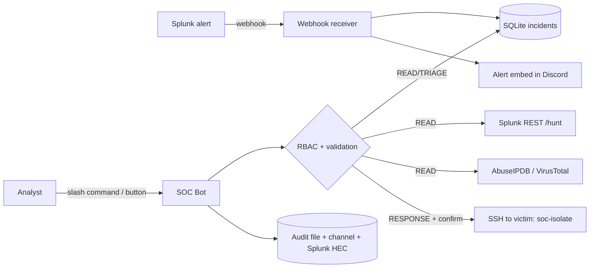

# SOC Automation Bot & Incident Triage Assistant

A Discord ChatOps bot, written in Python, for a fully local SOC lab. Splunk alerts arrive through a webhook into a small SQLite incident store. Analysts triage, enrich, hunt, contain and close incidents from chat. Every action is checked against role-based access control and written to an audit log that is also forwarded to Splunk.

See [docs/architecture.md](docs/architecture.md) for the lab and [docs/bot-refactor-plan.md](docs/bot-refactor-plan.md) for how the bot moved from Azure to Splunk.

---

## Features

| Area | What it does |
|---|---|
| **Alert intake** | Splunk alert webhook, shared-secret checked and validated, stored in SQLite, posted as an embed with Acknowledge, Enrich and Isolate buttons |
| **Triage** | List, show, comment on and close incidents (`true_positive`, `false_positive`, `benign`) |
| **Hunting** | `/hunt` runs predefined read-only SPL templates through the Splunk REST API. Chat input only fills validated parameters |
| **Enrichment** | IP reputation from AbuseIPDB and VirusTotal. Private IPs are never sent to third parties. A failed lookup yields an `Incomplete` verdict, never `Clean` |
| **Containment** | Isolate or release a host over SSH as a restricted `responder` user that may only run two sudoers-listed scripts |
| **RBAC** | Three role tiers (READ, TRIAGE, RESPONSE) mapped to Discord role IDs, plus a required channel allow-list |
| **Safety rails** | Confirmation buttons only the requester can press, an isolation deny-list, an SSH host allow-list, strict input validation |
| **Audit** | JSON Lines file, optional `#soc-audit` channel feed, and forwarding to Splunk HEC (index `soc_audit`) |
| **Mock mode** | In-memory incidents, Splunk, SSH and threat-intel data for demos |

## Commands

| Command | Tier | Backend |
|---|---|---|
| `/incident list [status] [severity] [limit]` | READ | SQLite store |
| `/incident show <incident>` | READ | SQLite store (details and last comments) |
| `/enrich <ip> [incident]` | READ | AbuseIPDB, VirusTotal; result added as an incident comment if linked |
| `/hunt <template> [window] [target]` | READ | Splunk REST `:8089`, `services/search/jobs/export` |
| `/incident comment <incident> <message>` | TRIAGE | SQLite store |
| `/incident close <incident> <classification> <comment>` | TRIAGE | SQLite store |
| `/isolate <host> <reason> <incident>` | RESPONSE | SSH `sudo soc-isolate` |
| `/unisolate <host> <reason> <incident>` | RESPONSE | SSH `sudo soc-unisolate` |
| `/soc-help` | any | Shows the commands and your tier |

`<incident>` is the incident number shown in the list (for example `12`).

Command-to-backend flowcharts are in [docs/flowchart.md](docs/flowchart.md).



## Project layout

```
soc_bot/
├── __main__.py            # entry point: python -m soc_bot
├── config.py              # env-based settings + validation
├── rbac.py                # Permission tiers and AccessPolicy
├── validators.py          # incident ref / IP / hostname validation, deny-list
├── audit.py               # JSON Lines audit logger
├── models.py              # Incident, Comment, IsolationResult, IpReport
├── hunts.py               # predefined SPL templates and parameter validation
├── webhook.py             # Splunk alert receiver (aiohttp)
├── store/incidents.py     # SQLite incident store
├── clients/
│   ├── base.py            # API error types + readable error extraction
│   ├── splunk.py          # REST search client and HEC audit forwarder
│   ├── ssh_response.py    # asyncssh isolation with a fixed command set
│   ├── enrichment.py      # AbuseIPDB + VirusTotal
│   └── mock.py            # in-memory fakes for demo mode
└── discord_bot/
    ├── bot.py             # SocBot: wiring, webhook server, error handling, audit
    ├── checks.py          # @require(Permission.X) and ensure()
    ├── views.py           # Confirm/Cancel button view
    ├── alerts.py          # persistent Acknowledge/Enrich/Isolate buttons
    ├── embeds.py          # all Discord embed rendering
    └── cogs/              # incidents, enrichment, hunt, response, general
infra/
├── auditd/soc.rules       # victim auditd rule
└── responder/             # soc-isolate, soc-unisolate, sudoers entry for the victim
tests/                     # pytest: RBAC, validators, store, webhook, Splunk client, config
```

## Setup

### 1. Discord application

1. Go to <https://discord.com/developers/applications>, create a **New Application**, open **Bot**, then **Reset Token**. Copy the token into `DISCORD_TOKEN`.
2. Leave all privileged intents off. The bot doesn't need them.
3. In **OAuth2 → URL Generator**, select the `bot` and `applications.commands` scopes and the *Send Messages* and *Embed Links* permissions. Use the generated URL to invite the bot.
4. Create roles such as `SOC-L1` (READ), `SOC-L2` (TRIAGE) and `SOC-IR` (RESPONSE). Enable *Developer Mode*, then right-click each role and channel to copy its ID.

### 2. Splunk

1. **Search token:** Settings → Tokens → New Token for a user with search rights. Put it in `SPLUNK_TOKEN` and set `SPLUNK_URL=https://<siem>:8089`. For the lab's self-signed certificate, set `SPLUNK_VERIFY_TLS=false`.
2. **Alert webhook:** in each alert, add the **Webhook** action with URL `http://<bot-host>:8765/webhook/splunk?secret=<WEBHOOK_SECRET>`. Splunk's built-in action cannot set headers, so the secret goes in the query string. Other senders can use the `X-Webhook-Secret` header. Have the SPL return `host`, `src_ip` and `severity` fields so the bot can fill the incident.
3. **Audit forwarding (optional):** create an HEC token allowed to write to index `soc_audit`, then set `SPLUNK_HEC_URL` and `SPLUNK_HEC_TOKEN`.

Test the webhook without Splunk:

```powershell
curl.exe -X POST "http://127.0.0.1:8765/webhook/splunk" -H "X-Webhook-Secret: $env:WEBHOOK_SECRET" -H "Content-Type: application/json" -d '{\"search_name\":\"Test alert\",\"result\":{\"host\":\"soc-victim\",\"src_ip\":\"185.220.101.4\",\"severity\":\"high\"}}'
```

### 3. Victim host (isolation)

1. Create the `responder` user and add the bot's public key to its `authorized_keys`.
2. Copy [infra/responder/soc-isolate](infra/responder/soc-isolate) and [soc-unisolate](infra/responder/soc-unisolate) to `/usr/local/sbin/` (root-owned, mode 0755). Edit `MGMT_IP` in `soc-isolate` if the SIEM address differs.
3. Install [responder.sudoers](infra/responder/responder.sudoers) as `/etc/sudoers.d/responder` (mode 0440) and check it with `visudo -cf`.
4. On the bot host, connect once with SSH so the victim's host key is in `known_hosts`. The bot always verifies host keys.
5. Set `RESPONDER_HOSTS=soc-victim=192.168.56.20` and `RESPONDER_SSH_KEY=<path to private key>`.

### 4. Run

```powershell
python -m venv .venv
.\.venv\Scripts\Activate.ps1          # Linux/macOS: source .venv/bin/activate
pip install -r requirements.txt
copy .env.example .env                # then fill in the values
python -m soc_bot
```

Set `DISCORD_GUILD_ID` so that slash commands sync to your server immediately. `ALLOWED_CHANNEL_IDS`, at least one RBAC role and `WEBHOOK_SECRET` are required. Splunk, HEC and SSH are optional, and the matching commands report "not configured" until you set them.

## Security controls

- **Least privilege by tier:** READ < TRIAGE < RESPONSE. The bot refuses to start with no RBAC roles or no allowed channels, so it can never run open to everyone.
- **Scope limits:** commands work only in guilds, not DMs, in the allowed channels, and optionally in one guild (`DISCORD_GUILD_ID`). Alert buttons enforce the same checks.
- **Human in the loop:** close, isolate and unisolate need an explicit **Confirm** click from the analyst who ran the command. The prompt times out after 60 s.
- **Critical asset deny-list:** `ISOLATION_DENYLIST` (fnmatch patterns) is checked before any SSH connection.
- **No shell or SPL from chat:** SSH runs two fixed commands. SPL comes from templates, and only hostnames, IPs and time windows from fixed lists fill them. SQL is parameterised.
- **Restricted responder:** a dedicated user with `sudoers` access to two scripts only, a host allow-list in `RESPONDER_HOSTS`, and SSH host-key verification.
- **Webhook hardening:** constant-time secret check, 64 KB body limit, every field validated and truncated, bound to `127.0.0.1` by default.
- **Output safety:** Discord output escapes markdown, echoed input is stripped of markdown characters, and `AllowedMentions.none()` stops the bot from pinging anyone.
- **Data minimisation:** private and reserved IPs are never sent to AbuseIPDB or VirusTotal.
- **Accountability:** every action records the Discord user in the JSONL audit log, in an incident comment where relevant, and in Splunk HEC. The local file is append-only by convention, so the Splunk copy is the tamper-resistant one.
- **Secrets:** all secrets live in `.env` or environment variables (`.env` is git-ignored).

Example audit entry:

```json
{"ts": "2026-10-16T09:41:12+00:00", "actor": "analyst#0", "actor_id": 1234, "action": "device.isolate", "target": "soc-victim", "outcome": "success", "channel_id": 5678, "address": "192.168.56.20", "reason": "C2 beacon", "incident": 12}
```

## Mock mode

Mock mode serves sample incidents, canned Splunk rows, a fake SSH responder and threat-intel verdicts, so you can record a walkthrough without the lab:

```powershell
$env:SOC_BOT_MOCK="true"; python -m soc_bot
```

A Discord token, role IDs and channel IDs are still needed because the bot connects to Discord.

## Tests

```powershell
pip install -r requirements-dev.txt
pytest
```

The tests cover RBAC tiers, input validation and injection rejection, the incident store, webhook authentication and parsing, hunt template validation, Splunk REST and HEC clients through `httpx.MockTransport`, the verdict logic, and config validation. They make no network calls.
