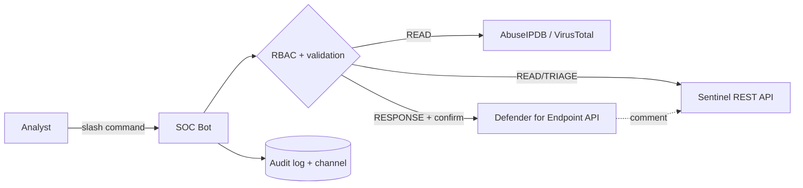

# SOC Automation Bot & Incident Triage Assistant

A Discord ChatOps bot, written in Python, that connects to **Microsoft Sentinel** and **Microsoft Defender for Endpoint**. Analysts can list, inspect, enrich, contain and close incidents from a chat channel without opening the Azure Portal. Every action is checked against role-based access control and written to an audit log.


> Record the walkthrough with `SOC_BOT_MOCK=true` (see [Recording the demo](#recording-the-demo)) and save it as `docs/media/demo.gif`.

---

## Features

| Area | What it does |
|---|---|
| **ChatOps** | `discord.py` slash commands, with one cog per area of responsibility |
| **Sentinel triage** | List, filter, show (with entities), comment on and close incidents through the SecurityInsights REST API |
| **Enrichment** | IP reputation from AbuseIPDB and VirusTotal, queried in parallel. Private IPs are never sent to third parties |
| **Containment** | Isolate or release devices through the Defender for Endpoint API. Every action must reference a Sentinel incident and is recorded there with an automatic comment |
| **RBAC** | Three role tiers (READ → TRIAGE → RESPONSE) mapped to Discord role IDs, with optional channel and guild allow-lists |
| **Safety rails** | Confirmation buttons that only the requester can press, a deny-list for critical hosts (DCs, ADFS…), etag concurrency checks on close, and strict input validation |
| **Audit** | A JSON Lines audit trail plus an optional `#soc-audit` channel feed covering successes, denials, cancellations and errors |
| **Mock mode** | In-memory Sentinel, MDE and TI data, so you can demo the bot without an Azure tenant |

## Commands

| Command | Tier | Azure / external API |
|---|---|---|
| `/incident list [status] [severity] [limit]` | READ | `GET …/incidents?$filter&$orderby&$top` |
| `/incident show <incident>` | READ | `GET …/incidents/{id}` → `POST …/incidents/{id}/entities` |
| `/enrich <ip> [incident]` | READ | AbuseIPDB `/api/v2/check`, VirusTotal `/api/v3/ip_addresses/{ip}` (+ incident comment if linked) |
| `/incident comment <incident> <message>` | TRIAGE | `PUT …/incidents/{id}/comments/{commentId}` |
| `/incident close <incident> <classification> <comment>` | TRIAGE | `PUT …/incidents/{id}` (status, classification, reason, etag) + `PUT …/comments/{commentId}` |
| `/isolate <host> <reason> <incident> [isolation_type]` | RESPONSE | MDE `GET /api/machines?$filter` → `POST /api/machines/{id}/isolate` + incident comment |
| `/unisolate <host> <reason> <incident>` | RESPONSE | MDE `POST /api/machines/{id}/unisolate` + incident comment |
| `/soc-help` | any | Shows the commands and your tier |

`<incident>` accepts either the incident number analysts see in the portal (e.g. `1042`) or the incident GUID.

The flowcharts that map each command to its REST endpoints are in [docs/flowchart.md](docs/flowchart.md).



## Project layout

```
soc_bot/
├── __main__.py            # entry point: python -m soc_bot
├── config.py              # env-based settings + validation
├── rbac.py                # Permission tiers and AccessPolicy
├── validators.py          # incident ref / IP / hostname validation, deny-list
├── audit.py               # JSON Lines audit logger
├── models.py              # Incident, Entity, Machine, MachineAction, IpReport
├── clients/
│   ├── base.py            # bearer token helper + API error mapping
│   ├── sentinel.py        # Microsoft Sentinel (SecurityInsights) client
│   ├── defender.py        # Defender for Endpoint machine actions
│   ├── enrichment.py      # AbuseIPDB + VirusTotal
│   └── mock.py            # in-memory fakes for demo mode
└── discord_bot/
    ├── bot.py             # SocBot: client wiring, command sync, error handling, audit
    ├── checks.py          # @require(Permission.X) app-command check
    ├── views.py           # Confirm/Cancel button view
    ├── embeds.py          # all Discord embed rendering
    └── cogs/
        ├── incidents.py   # /incident list|show|comment|close
        ├── enrichment.py  # /enrich
        ├── response.py    # /isolate, /unisolate
        └── general.py     # /soc-help
tests/                     # pytest: RBAC, validators, API clients (httpx MockTransport)
docs/flowchart.md          # command → endpoint flowcharts
```

The API clients have no Discord dependency, so you can add a Slack or Teams front end by writing a new adapter next to `discord_bot/`.

## Setup

### 1. Discord application

1. Go to <https://discord.com/developers/applications>, create a **New Application**, open **Bot**, then **Reset Token**. Copy the token into `DISCORD_TOKEN`.
2. Leave all privileged intents off. The bot doesn't need them.
3. In **OAuth2 → URL Generator**, select the `bot` and `applications.commands` scopes and the *Send Messages* and *Embed Links* permissions. Use the generated URL to invite the bot.
4. In your server, create roles such as `SOC-L1` (READ), `SOC-L2` (TRIAGE) and `SOC-IR` (RESPONSE). Enable *Developer Mode*, then right-click each role to **Copy Role ID**.

### 2. Azure / Entra ID app registration

1. **Entra ID → App registrations → New registration**. Create a client secret, or use a managed identity or workload identity when hosting in Azure.
2. **Sentinel:** assign the app the **Microsoft Sentinel Responder** role on the workspace's resource group. This lets it read and update incidents and add comments.
3. **Defender for Endpoint:** under **API permissions → APIs my organization uses → WindowsDefenderATP → Application permissions**, add `Machine.Read.All` and `Machine.Isolate`, then **grant admin consent**.
4. The bot authenticates with `DefaultAzureCredential`. Set `AZURE_TENANT_ID`, `AZURE_CLIENT_ID` and `AZURE_CLIENT_SECRET`, or rely on a managed identity.

### 3. Run

```powershell
python -m venv .venv
.\.venv\Scripts\Activate.ps1          # Linux/macOS: source .venv/bin/activate
pip install -r requirements.txt
copy .env.example .env                # then fill in the values
python -m soc_bot
```

Set `DISCORD_GUILD_ID` so that slash commands sync to your server immediately. Global sync can take up to an hour.

## Security controls

- **Least privilege by tier:** READ < TRIAGE < RESPONSE. The bot refuses to start if no RBAC roles are configured, so it can never run open to everyone.
- **Scope limits:** commands work only in guilds, not DMs. You can also pin the bot to one guild (`DISCORD_GUILD_ID`) and specific channels (`ALLOWED_CHANNEL_IDS`).
- **Human in the loop:** close, isolate and unisolate all need an explicit **Confirm** click from the analyst who ran the command. The prompt times out after 60 s.
- **Critical asset deny-list:** `ISOLATION_DENYLIST` (fnmatch patterns) is checked against both the typed hostname and the resolved FQDN.
- **Injection-safe inputs:** incident references must be a positive integer or a GUID. Hostnames must match strict DNS rules, IPs are parsed with `ipaddress`, and severity and status come from fixed choices. Nothing free-form ever reaches an OData `$filter`.
- **Output safety:** comments written to Sentinel are HTML-escaped, Discord output escapes markdown, and `AllowedMentions.none()` stops the bot from pinging anyone.
- **Data minimisation:** private and reserved IPs are never sent to AbuseIPDB or VirusTotal.
- **Concurrency:** closing an incident sends the incident `etag`, so the bot won't silently overwrite another analyst's change (HTTP 412 tells the user to retry).
- **Accountability:** every action records the Discord user in the JSONL audit log, in the MDE action comment and in the Sentinel incident comment.
- **Secrets:** all secrets live in `.env` or environment variables (`.env` is git-ignored). In production, prefer managed identity and Key Vault.

Example audit entry:

```json
{"ts": "2026-10-13T09:41:12+00:00", "actor": "analyst#0", "actor_id": 1234, "action": "device.isolate", "target": "ws-fin-017.corp.contoso.com", "outcome": "success", "channel_id": 5678, "machine_id": "a1b2…", "action_id": "7f0e…", "reason": "C2 beacon to Tor exit", "isolation_type": "Full", "incident": 1042}
```

## Recording the demo

Mock mode serves realistic sample incidents, devices and TI verdicts, so you can record a walkthrough without touching production:

```powershell
$env:SOC_BOT_MOCK="true"; python -m soc_bot
```

Suggested script (about 60–90 s):

1. `/soc-help` to show your tier.
2. `/incident list` to show the open incidents (#1042 is High).
3. `/incident show 1042` to show the details and entities (host `ws-fin-017`, IP `185.220.101.4`).
4. `/enrich 185.220.101.4`, which returns **Malicious** (Tor exit, AbuseIPDB 100).
5. `/isolate ws-fin-017 reason:"C2 to Tor exit node" incident:1042`, then **Confirm**.
6. `/isolate dc01 reason:"test" incident:1042`, which is **blocked** by the deny-list.
7. From an account with only the READ role, run `/incident close 1042 …`, which is **denied**.
8. `/incident close 1042 classification:"True Positive" comment:"Host contained, reimage scheduled"`, then **Confirm**.
9. Show the `#soc-audit` channel.

Capture it with OBS, ShareX or ScreenToGif, then save it as `docs/media/demo.gif` (or link an MP4 or YouTube video).

## Tests

```powershell
pip install -r requirements-dev.txt
pytest
```

The tests cover RBAC tier logic, input validation and injection rejection, OData query construction, the close payload (classification, reason and etag), error mapping, and MDE device resolution and isolation, all through `httpx.MockTransport`. They make no network calls.
