# Lab architecture

The project runs as a **fully local SOC lab** on one Windows 11 host with VirtualBox. There is no cloud dependency and no Azure cost. An attack is generated by MITRE Caldera, recorded on a victim machine, parsed in a pipeline, detected in Splunk, and handled by a Discord ChatOps bot.

> Status legend: ✅ built and tested, 🔧 in progress, ⏳ planned.

## Data flow

```mermaid
flowchart LR
    subgraph ATK["soc-attacker · 192.168.56.30"]
        CAL["MITRE Caldera<br/>(web UI :8888)"]
    end

    subgraph VIC["soc-victim · 192.168.56.20"]
        AG["Sandcat agent"]
        AUD["auditd (execve rule)<br/>+ auth.log"]
        FB["Filebeat ⏳"]
    end

    subgraph SIEM["soc-siem · 192.168.56.10 ⏳"]
        LS["Logstash<br/>parse · enrich · filter"]
        SP["Splunk Enterprise<br/>index: linux"]
        BOT["SOC Discord bot<br/>+ SQLite incident store"]
    end

    ANA(("Analyst<br/>in Discord"))

    CAL -- "operation / abilities" --> AG
    AG -- "runs commands" --> AUD
    AUD -- "audit.log" --> FB
    FB -- "Beats :5044" --> LS
    LS -- "HEC :8088" --> SP
    SP -- "alert webhook" --> BOT
    BOT <-- "slash commands" --> ANA
    BOT -- "/hunt REST :8089" --> SP
    BOT -- "SSH isolate (restricted user)" --> VIC
```

## Network plan

Each VM has two adapters.

| Adapter | Type | Purpose |
|---|---|---|
| 1 | NAT | Internet access for package installs (10.0.2.15 inside every VM) |
| 2 | Host-only, `192.168.56.0/24` | Lab traffic and SSH from Windows (`192.168.56.1`) |

| VM | Role | OS | Host-only IP | RAM | Status |
|---|---|---|---|---|---|
| `soc-attacker` | Caldera C2 / red team | Ubuntu Server 24.04.5 | 192.168.56.30 | 4 GB | ✅ |
| `soc-victim` | Monitored endpoint | Ubuntu Desktop 24.04.5 | 192.168.56.20 | 4 GB | ✅ (Filebeat ⏳) |
| `soc-siem` | Splunk + Logstash + bot | Ubuntu Server 24.04 | 192.168.56.10 | 8 GB | ⏳ |

The host-only network is isolated from the real LAN, so the attack simulation can never leave the machine.

## Component status

| Component | Status | Notes |
|---|---|---|
| Caldera server on attacker | ✅ | Web UI on `:8888`, ran in tmux |
| Sandcat agent on victim | ✅ | Beacons over HTTP to `192.168.56.30:8888`, group `red` |
| auditd `execve` rule on victim | ✅ | Key `exec_cmd`; Caldera commands verified in the log |
| Filebeat → Logstash → Splunk | ⏳ | Next block of work |
| Splunk detections (SPL) | ⏳ | Alerts via webhook to the bot |
| Discord bot | 🔧 | Migrated to Splunk webhook, SQLite store, `/hunt` and SSH isolation (see `bot-refactor-plan.md`); not yet run against live Splunk or the victim VM |

## Design decisions

- **Local lab instead of Sentinel/Azure.** Removes cloud cost and tenant risk, and makes the project reproducible by anyone with a laptop.
- **Logstash between the endpoint and Splunk.** Logs are parsed, enriched, and filtered before ingestion, which keeps noise (for example `debian-sa1` cron jobs) out of the SIEM.
- **Own SQLite incident store.** Splunk raises alerts, but incident state (open, assigned, closed) lives in the bot's database, so triage works without a case-management product.
- **Restricted response user.** Isolation runs over SSH as a dedicated `responder` account limited by `sudoers` to a single script, so a compromised bot cannot run arbitrary commands on the endpoint.
