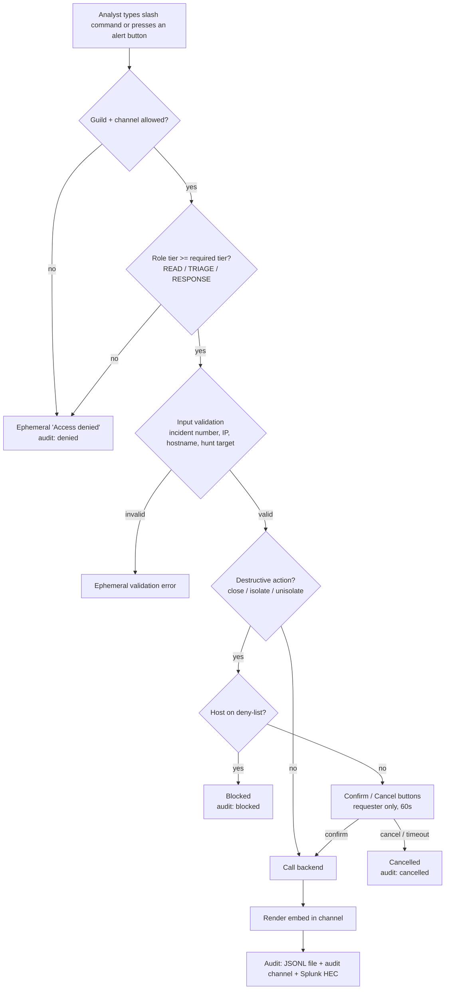
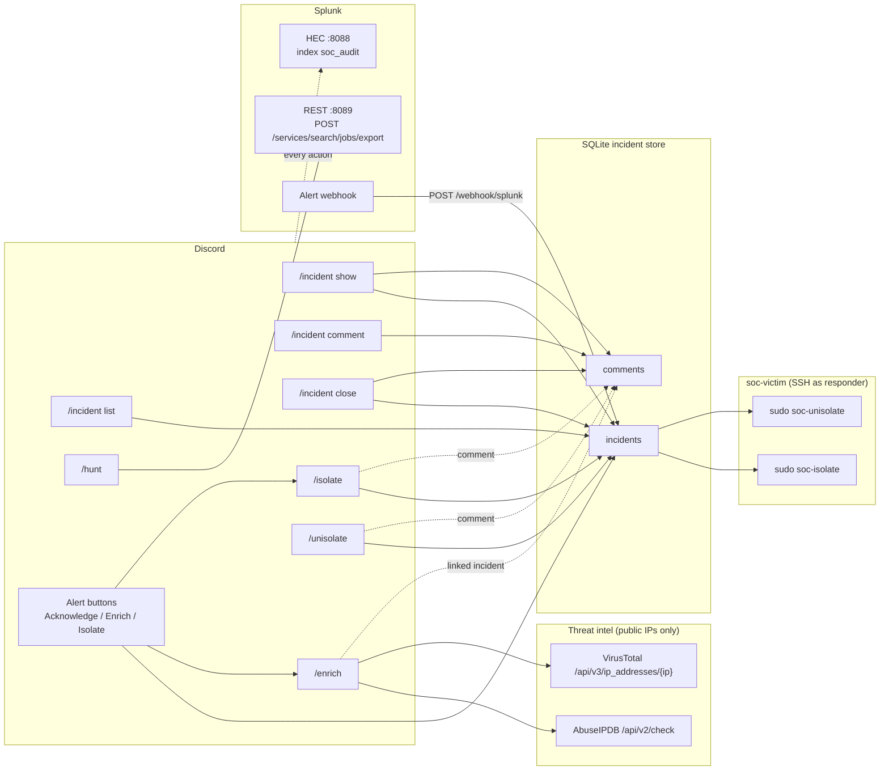
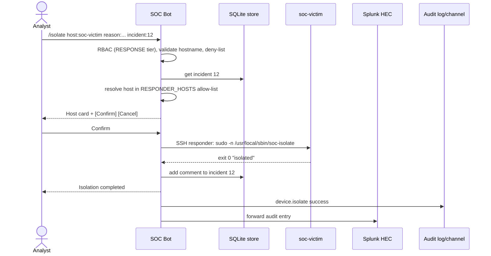
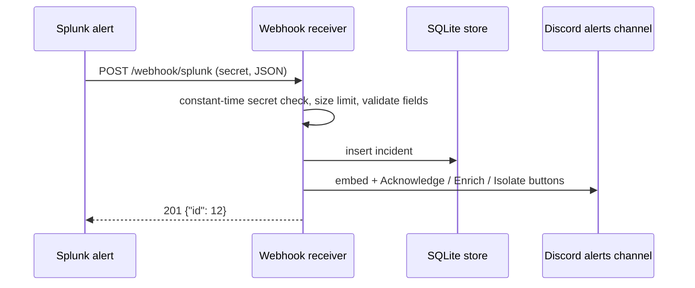

# Command → backend flow

Every slash command and alert button passes through the same guard pipeline before any backend call is made.

## Request pipeline

## Command → backend map

## `/isolate` sequence

## Alert intake sequence

