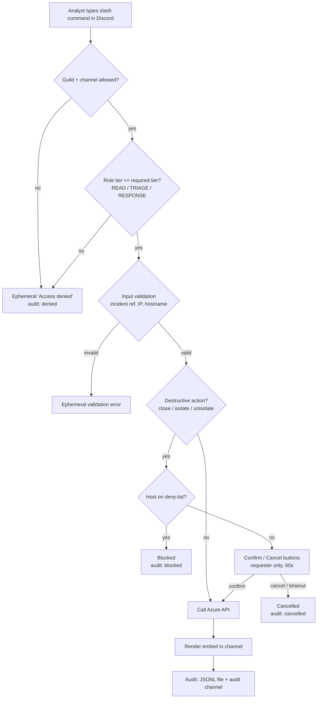
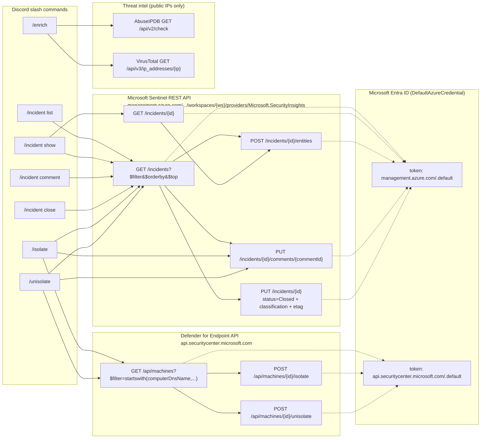
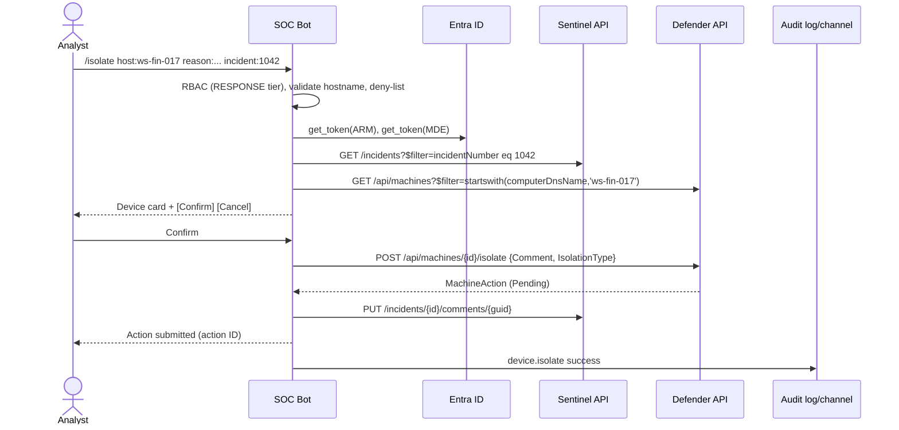

# Command → Azure REST API flow

Every slash command passes through the same guard pipeline before any API call is made.

## Request pipeline

## Command → endpoint map

> Incident numbers (e.g. `1042`) are resolved to incident GUIDs with
> `GET /incidents?$filter=properties/incidentNumber eq 1042`; GUIDs go straight to `GET /incidents/{id}`.

## `/isolate` sequence

