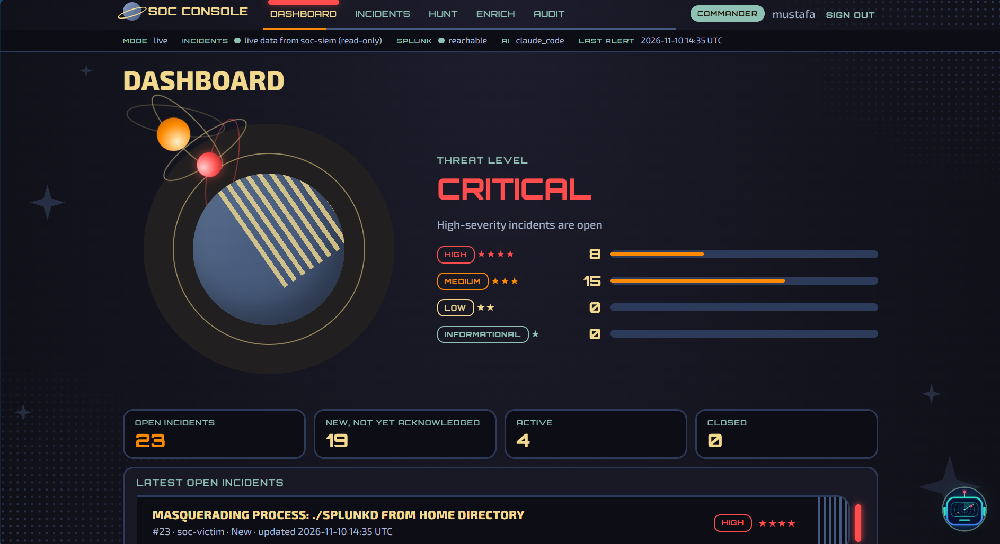
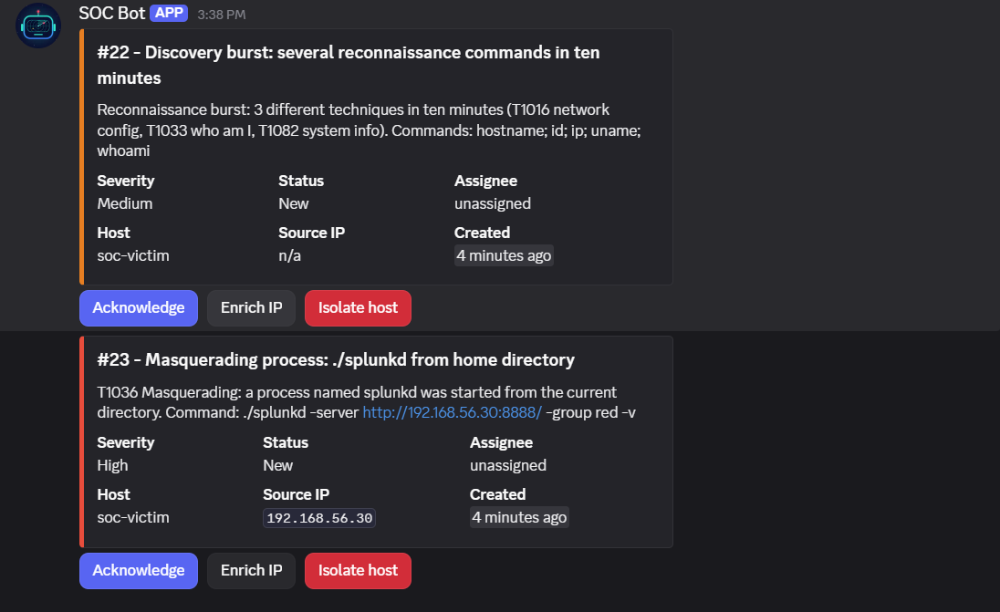
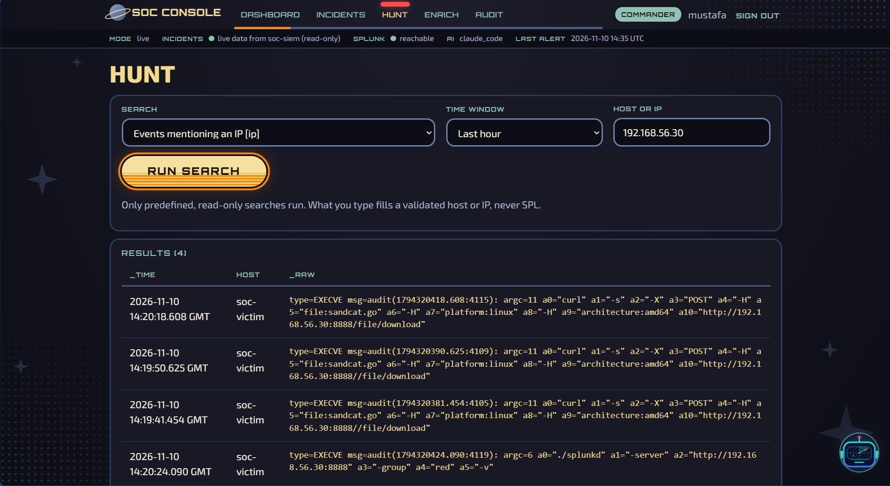
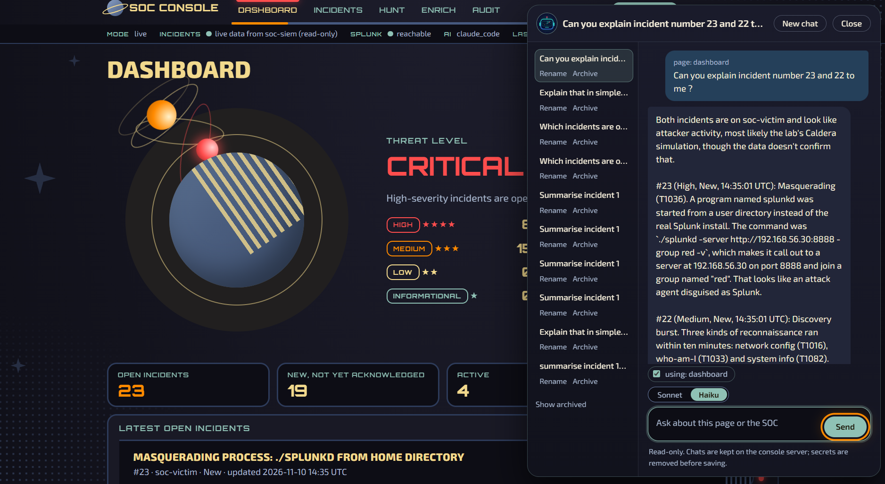
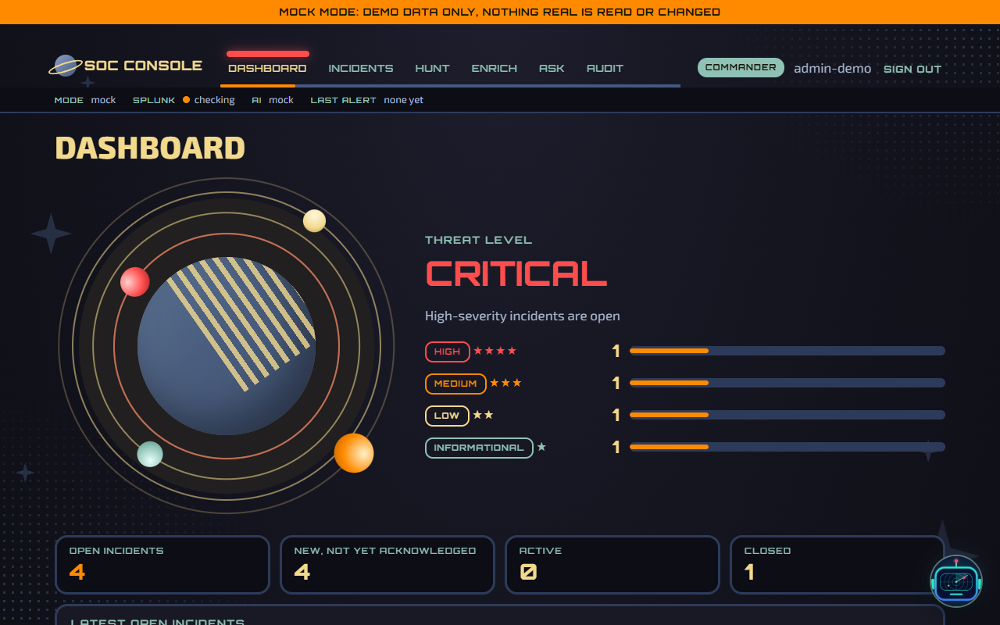
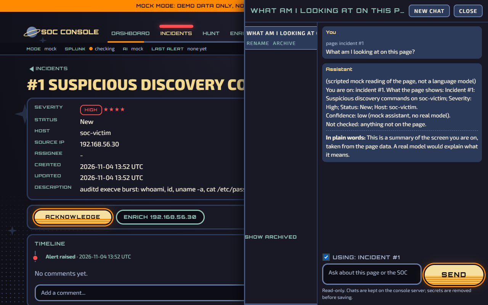
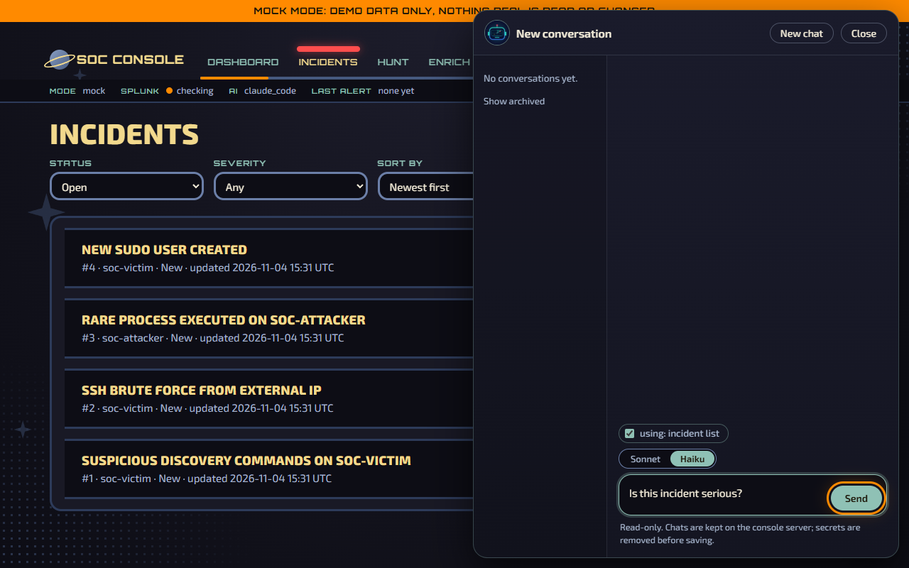
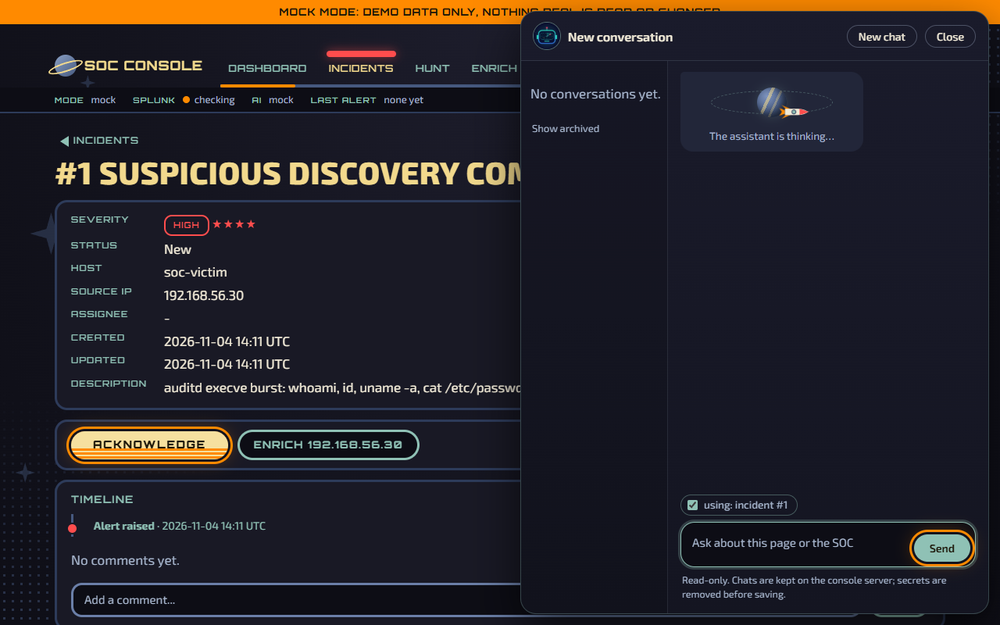
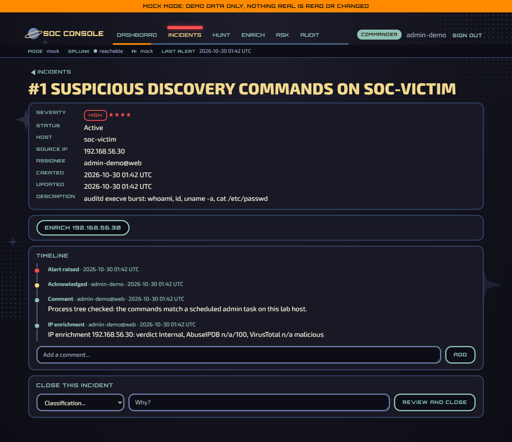
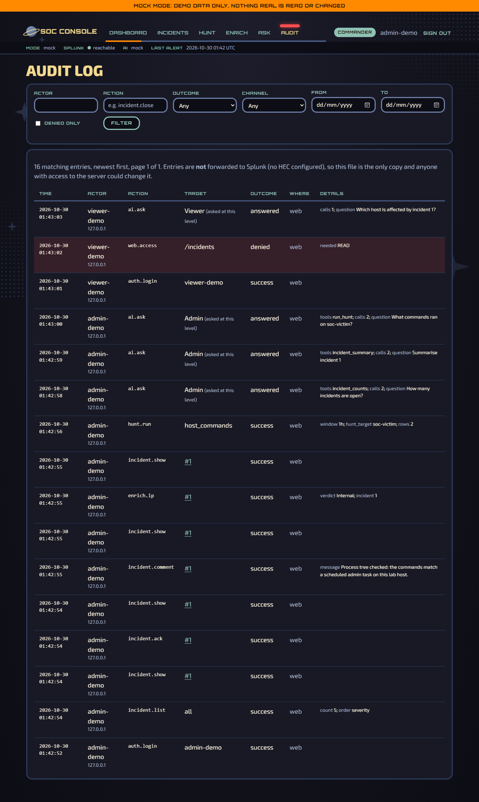

# Web console

A Flask app in [`soc_web/`](../soc_web/) that gives analysts the bot's triage workflow in a browser. It runs as its own process (`python -m soc_web`) and uses the same incident store, hunt templates, enrichment clients, AI assistant and audit log as the Discord bot.

## In plain words

The console is a web page where the SOC team can see security alerts ("incidents"), look into them, add notes, and close them once they are dealt with. It also has a question box (Ask) where anyone can ask the AI assistant about the SOC, and it only answers with what that person is allowed to know.

- **Everyone signs in** with their own account. Accounts are created by whoever runs the server, never on the web page.
- **What you can do depends on your level.** A *viewer* sees only totals and can ask the assistant for summaries. An *analyst* (read) can look at incidents, hostnames and addresses, run hunts and check an IP's reputation. *Triage* can also acknowledge, comment and close. *Admin* can also read the audit log, the record of who did what.
- **It cannot isolate a computer.** That stays in the Discord bot.
- **Everything people do is written to an audit log.**
- **Keep it on your own machine** (`http://127.0.0.1:8080`). It does not encrypt traffic itself, so using it from another computer needs a TLS proxy in front (see below).

The rest of this page is for the person setting it up.

> **Localhost only, unless a TLS proxy is in front.** The server speaks plain HTTP, so sign-in passwords and session cookies cross the network unencrypted on any address other than `127.0.0.1`. It binds to `127.0.0.1` by default. To reach it from another machine, put a TLS reverse proxy in front and keep `SOC_WEB_SECURE_COOKIES=true`. The console logs a warning if it is started on any other address.



One real run in the lab: a Caldera agent disguised as `splunkd` produced two incidents. Below are the cards the bot posted to Discord, a Hunt for the attacker address, and the chat assistant explaining both incidents.







## What it does

| Page | Minimum tier | What it does |
|---|---|---|
| Dashboard | VIEWER | Counts of incidents by status and open ones by severity; the latest open incidents for READ and above |
| Incidents, incident detail | READ | Filter by status and severity; the detail page has a timeline (alert raised, acknowledgements, comments, AI triage notes, IP enrichments, close) |
| Acknowledge, comment, close | TRIAGE | Close takes a second confirmation page, like the bot's confirm button |
| Enrich | READ | AbuseIPDB and VirusTotal verdict for an IP; optionally recorded as an incident comment |
| Hunt | READ | The predefined read-only SPL templates from `soc_bot/hunts.py`; input only fills a validated host or IP |
| Ask | VIEWER | The AI assistant, answering at the signed-in user's tier. Shows that level, example questions that fit it, and shows a refusal in its own amber panel |
| Audit | ADMIN | Filter by actor, action, outcome, channel (`web`, `discord`, `cli`), date range, or "denied only"; 50 per page, newest first. Incident entries link to the incident; `ai.ask` rows show the asker's level, tools used and whether anything was refused |

A strip under the header shows **mode** (mock or live), **Splunk** (reachable, unreachable, not configured), the **AI** backend (off, mock, claude_code) and when the **last alert** arrived. Splunk is checked in the background at most every 30 seconds, so a down Splunk never slows a page. "Last alert" is the newest incident in the shared database; it shows the bot's webhook has delivered something recently, not that the webhook is up.

Tiers are the bot's (`VIEWER < READ < TRIAGE < RESPONSE < ADMIN`). **There is no isolate or release button**: the console is built without the SSH client, and the assistant is given none either.

The assistant's per-tool clearance is shared code with the bot. The page-level tiers in the table are set in `soc_web/app.py` (`@needs(...)`) to match the bot's `@require(...)` commands, so if you change a command's tier in one place, change it in the other.

**Follow-up questions.** The console remembers the signed-in user's last two answered questions for 30 minutes (in memory only, never written to disk), so "Explain that in simpler terms" has something to refer to. Only answers backed by a lookup are remembered; refusals and explanations are not. Each remembered answer is tagged with the level it was given at and is offered back only while the user's level is at least that high, so lowering an account's tier drops what it saw before, and one user never sees another's history. Signing out or pressing "Forget them" clears it. The earlier text goes to the assistant as escaped, length-capped data inside `<earlier_exchanges>`, and the prompt says it is context only and never widens the tools or level. Follow-up questions are marked `followup` in the audit log.

**The mock assistant is scripted.** With `AI_BACKEND=mock` the assistant only matches keywords, and follow-ups like "explain that" get a fixed, labelled re-wording of the earlier answer ("scripted mock explanation, not a language model"). Real explanations need `AI_BACKEND=claude_code`.

## The chat button

Every signed-in page has a round button at the bottom right (not the sign-in page). It opens a slide-over chat with a list of your past conversations on the left; Escape or Close shuts it. There is no separate Ask page: the chat button is the only way to ask, and it needs JavaScript.





- **Same assistant, nothing new.** A question goes through `backends.assistant.ask`, so it uses whichever `AI_BACKEND` is set (the scripted mock for demos, or the `claude_code` relay). There is no new backend and no API key, and no new way for other users to reach the relay: the routes need a signed-in session and a CSRF token, and the assistant's own per-user hourly limit and daily budget apply. The assistant has no write tools, so nothing can be isolated, closed or commented from the chat.
- **It sees the page you are on.** The chip under the conversation ("using: incident #10") says what is attached, and a checkbox turns it off. The browser sends only the address of the page; it never sends page text. The server rebuilds the context itself from the same data the page shows, for the same tier that may open it: the dashboard, the incident list (with its filters), one incident with its timeline, the last hunt result, the last enrichment result, and the audit rows (admins). Any other page sends only its name. A user below the page's tier gets no context at all. The context is capped at 3000 characters, run through the same secret redaction as the audit log, and contains no HTML.
- **Page text is data, not instructions.** Incident descriptions and commands come from alerts and can hold attacker-controlled text. The context goes into the prompt inside `<page_context>` with `<` and `>` escaped so it cannot close the tag, and the system prompt says everything inside is data and never to be followed (it should be reported as suspicious instead).
- **Conversations are kept.** Chats are stored in the console's own database, the same file as the accounts (`SOC_WEB_USERS_DB`, `web_users.db` by default, git-ignored), in the tables `chats` and `chat_messages`. They are the opposite of the short follow-up memory above: they are written to disk and survive a restart. They are never deleted, only renamed or archived (Archive, then "Show archived" to see them or Restore one). A conversation holds at most 60 messages, each message is cut at 4000 characters, and the title is taken from the first question. Secrets are redacted before anything is stored. Keep that file private: it now holds what people asked and what the assistant answered.
- **Each conversation belongs to one user at one tier.** Lookups match both, so a user given a lower or higher tier starts with an empty list, and a lower tier never reads what a higher tier discussed. Moving back to the earlier tier brings the old list back. No chat text is kept in the browser: no localStorage, and the script writes text only with `textContent`, never as HTML. The one thing the tab remembers (in `sessionStorage`, for that tab only) is whether the panel is open and the number of the conversation it shows, so moving to another page does not close it.
- **No scrollbars in the chat.** The conversation, the conversation list and the question box scroll with the mouse wheel, touch or keyboard (the conversation can be focused and scrolled with the arrow keys and Page Up/Down) but show no scrollbar.
- **Changing page does not lose the chat.** Every console page is a full page load, so the panel is put back as it was: open, on the same conversation. A question is saved before its answer is fetched, so if you move to another page while the assistant is still working, the answer is stored when it arrives and the chat on the next page waits for it (and shows the loading animation) instead of losing it. If the assistant fails, a short "did not answer" reply is stored, so nothing stays waiting.
- **With the real assistant, data leaves the lab.** With `AI_BACKEND=claude_code`, the question, the earlier exchanges and the page context (host names, IP addresses, commands and incident text, after secret redaction) are sent to Anthropic through the Claude login of whoever runs the console. That is acceptable for a lab with made-up data; it is not for real data. With the mock backend (`AI_BACKEND=mock`) everything stays on the machine and nothing is sent anywhere.
- **The real assistant is for the owner only.** The relay uses a personal Claude subscription login. The project owner's reading of Anthropic's terms is that such a login is for your own use of the unmodified Claude Code, so the relay (and so the chat button with `AI_BACKEND=claude_code`) runs only on the owner's own PC, for the owner, and only when the owner asks a question. It is not to be switched on on `soc-siem`, for other users, or for always-on or automatic use (no automatic triage notes, no retries). Re-read the terms before changing that.
- **The software enforces this.** The Discord bot refuses to start with `AI_BACKEND=claude_code` (it exits with a configuration error saying to use `mock` or `off`), so its automatic triage notes can never use the relay. The console starts with `claude_code` only when `SOC_WEB_HOST` is `127.0.0.1`, `::1` or `localhost`; with any other address (including `0.0.0.0`) it refuses to start. This guards against a slip, not against someone who edits the code.
- **Sonnet or Haiku.** With `AI_BACKEND=claude_code` the chat panel has a small Sonnet / Haiku switch, and each question is answered by the model chosen when it was sent. Sonnet is the default; Haiku is quicker and lighter. The choice is remembered for the tab, like the open panel, and is written to the audit log as `model`. It exists only with the real assistant (the mock ignores it, so the switch is hidden). The console passes Claude Code's own names `sonnet` and `haiku`, and nothing else: any other value sent by a browser is ignored and the default is used, so a request can never add a command-line option. The owner's own `AI_MODEL` setting is still the default when no choice is made. Both models are reached through the same personal login, so the notes above about data leaving the lab and owner-only use apply to both.

  
- **One question at a time.** A user can have only one question being answered, whichever tab or page it came from, so a double click or a quick reload cannot start a second call to the assistant or the relay (the second attempt gets "Your previous question is still being answered" and is not counted against the hourly limit). The assistant's own per-user hourly limit and daily budget still apply to the question that does run. Nothing retries by itself: a failed question stores a short reply and stops, and only a person pressing Send asks again. The chat finds a pending answer by reading, which never calls the assistant.
- **A conversation number from the tab is not trusted.** The tab remembers a number, and every request using it is checked on the server against the signed-in user and their current role. Someone else's number, or one from another role, gets "does not exist".
- **Loading animation.** While an answer is on its way the chat shows a small rocket on a hairline orbit around a planet, with a faint trail and the words "The assistant is thinking". The rocket flies a lap in a second and a half at a constant speed, turns smoothly along the path (it is never mirrored), passes in front of the planet on the near side and behind it on the far side, and grows and fades a little with distance on a sine curve so nothing pulses or stalls. It is pure CSS (`soc_web/static/style.css`, markup in `templates/_chat.html`) and rests on the orbit when the browser asks for reduced motion. The mock answers instantly, so to look at it open any page with `#chat-loading-demo` at the end of the address (for example `/incidents#chat-loading-demo`) and open the chat.

  
- **Audit.** A new conversation is `chat.new`; renaming and archiving are `chat.rename`, `chat.archive` and `chat.unarchive`; every question is the usual `ai.ask` entry with `page` (what was attached), `conversation` and `via` (`widget` or `ask`).
- **The round button's picture** is the bot's logo, `soc_web/static/bot-avatar.png` (also shown small in the panel header). Replace that file to change it; if it is missing the button shows the letters "AI".

**How answers are shown.** In the chat the assistant's answer is shown as text, and below it a line called **In plain words** shows 2 or 3 non-technical sentences. The assistant's prompt asks for that part after "Not checked:", and never on a refusal, so refusals stay word for word. The parsing lives in `soc_web/answers.py`. The prompt change is in `soc_bot/ai/prompt.py`, so Discord answers carry the same "In plain words:" paragraph, as plain text.





Pages a user's tier does not allow return 403, and the nav only shows what the account can open ([screenshot](screenshots/viewer-refused.png)).

## Run it

```powershell
pip install -r requirements.txt
python -c "import secrets; print(secrets.token_hex(32))"   # put the result in SOC_WEB_SECRET_KEY in .env
python -m soc_web user add alice --tier triage              # asks for the password twice
python -m soc_web                                           # http://127.0.0.1:8080
```

The console reads the same `.env` as the bot, but needs no Discord token, role IDs, channel IDs or `WEBHOOK_SECRET`. Point `DB_PATH` at the bot's incident database to see its incidents, or read them over the network from soc-siem (see "Live incidents from soc-siem"); alerts arrive through the bot's webhook, not the console.

Account commands: `user list`, `user passwd <name>`, `user tier <name> <tier>`, `user disable <name>`, `user enable <name>`. There is no sign-up page and no admin page for accounts, on purpose: accounts are made on the machine that runs the console.

Settings (all optional except the secret key; see `.env.example`):

| Variable | Default | Meaning |
|---|---|---|
| `SOC_WEB_SECRET_KEY` | none | Signs sessions (can be a 1Password reference, see [secrets.md](secrets.md)). 32+ characters; the server refuses to start without it (mock mode makes a temporary one) |
| `SOC_WEB_HOST`, `SOC_WEB_PORT` | `127.0.0.1`, `8080` | Where it listens. On the lab VM, ports 8000, 8088, 8089 and 8888 (Splunk Web, HEC, Splunk API, Caldera) and 5044 (Logstash) are taken. To serve the VM's lab network, bind to its address (`SOC_WEB_HOST=192.168.56.10`) and set `SOC_WEB_ALLOWED_HOSTS` to that address, with a TLS proxy in front |
| `SOC_WEB_ALLOWED_HOSTS` | loopback + the bind address | Host names it answers to; any other `Host` header gets 400. Listening on `0.0.0.0` with no list accepts any, and logs a warning |
| `SOC_WEB_TRUSTED_PROXIES` | `0` | Number of TLS proxies in front. Above 0, `X-Forwarded-*` from them is believed |
| `SOC_WEB_SECURE_COOKIES` | `true` | Set `false` only for a plain-HTTP lab address |
| `SOC_WEB_SESSION_HOURS`, `SOC_WEB_MAX_FAILED_LOGINS`, `SOC_WEB_LOCKOUT_MINUTES` | `8`, `5`, `15` | Session length and lockout |
| `SOC_WEB_USERS_DB` | `web_users.db` | Accounts (git-ignored) |

**Demo:** with `SOC_BOT_MOCK=true` the console uses in-memory fake data and, if there are no accounts, creates `demo` (ADMIN) and prints its random password once.

## Live incidents from soc-siem

By default the console reads the incident database next to it (`DB_PATH`). To show the real incidents held by the bot on soc-siem from the console on your own PC, the bot offers a small **read-only API** and the console has a client for it.

- **On the bot (soc-siem):** set `API_SECRET` (at least 32 characters, different from `WEBHOOK_SECRET`; for example `python -c "import secrets; print(secrets.token_urlsafe(32))"`) and make the webhook listen on the host-only address instead of loopback (`WEBHOOK_HOST=<soc-siem address>`). The routes are `GET /api/incidents` (filters `status`, `severity`, `order`, `limit`, capped at 50), `GET /api/incidents/<id>` (with comments) and `GET /api/counts`. There are no POST, PUT or DELETE routes. With no `API_SECRET` the `/api` routes are not registered at all.
- **On your PC:** set `SOC_BOT_API_URL=http://<soc-siem address>:8765` and `SOC_BOT_API_SECRET=<the same value>`. Both or neither; the console refuses to start with only one. It cannot be combined with `SOC_BOT_MOCK=true`.
- **Reaching it:** the PC and soc-siem share the lab's host-only network, so the URL is the VM's host-only address (for example `http://192.168.56.10:8765`). From the PC, `curl.exe -H "X-Api-Secret: $env:SOC_BOT_API_SECRET" http://<soc-siem address>:8765/api/counts` is a quick check.
- **It is plain HTTP.** The secret and the incident text cross that network unencrypted, which is acceptable only on the isolated host-only network. Do not expose the port beyond it, and do not point the console at it over any other network without a TLS reverse proxy.
- **Read-only here.** In this mode the console hides Acknowledge, Close and Comment, and their routes refuse (HTTP 405, "read-only", and the refusal is audited). Enriching an incident's IP still works but does not write a comment onto it. Changing incidents stays in the Discord bot. The chat reads the same live incidents, so the assistant's tools see what the pages show.
- **Status strip.** An extra "Incidents" entry says "live data from soc-siem (read-only)" or "soc-siem offline". Timeouts are short (3 s to connect, 5 s in all) with one attempt and no retries, so a stopped VM shows a plain "unreachable" page, not a hang.
- **What the API returns.** Only incident fields and comments, with secret-looking text removed by the same redaction as the audit log (a safety net, not a guarantee). Errors are generic JSON with no stack traces. Requests are limited with the webhook's mechanism, on a separate budget so reading cannot delay alerts, and only authenticated requests count. The secret is compared in constant time, accepted only in the header, and never logged.
- **Rotation.** If the secret may have leaked, change `API_SECRET` on the bot and `SOC_BOT_API_SECRET` on the PC.

## Security notes

- **Passwords** are stored as scrypt hashes, at least 12 characters. After 5 failed sign-ins (configurable) an account is locked for 15 minutes, and each address may try 20 sign-ins per 5 minutes. A wrong username and a wrong password give the same answer and take about the same time.
- **Sessions** are signed cookies: `HttpOnly`, `SameSite=Lax`, `Secure` unless `SOC_WEB_SECURE_COOKIES=false`, and renewed at every sign-in. The user's tier is read from the database on every request, so disabling an account or lowering a tier applies at once. Each account has a session counter carried in the cookie: signing out, changing the password or disabling the account bumps it, so a copied cookie stops working at once instead of at its expiry. (Signing out therefore ends that user's sessions in every browser.)
- **Host header:** requests whose `Host` is not in the allowed list are refused (see settings).
- **CSRF:** every POST needs a per-session token.
- **Content Security Policy** allows no inline styles and no inline scripts. The sign-in page allows no script at all. Signed-in pages allow exactly one, `static/chat.js` from this site (`script-src 'self'`), which may talk only to this site (`connect-src 'self'`); no `unsafe-inline`, no `eval`, nothing from elsewhere. Alert text, comments and Splunk rows are untrusted, and Jinja escapes them. An alert link is only shown as a link if it is `http` or `https`.
- **Account changes** made with `python -m soc_web user ...` are written to the audit log as `account.create`, `account.passwd`, `account.tier`, `account.disable`, `account.enable` (channel `cli`, actor `cli:<operating-system user>`); failed sign-ins and lockouts appear as `auth.login` denied.
- **Secrets in free text** (API keys, tokens, JWTs, `password=...`, long hex strings) are replaced by `[redacted]` before anything is written to the audit log or sent to Splunk. This is a safety net, not a guarantee.
- **Audit:** every incident list or detail view, change, hunt, enrichment, question and audit view is written to the audit log with `channel: web` and the client address, and forwarded to Splunk HEC when that is configured. Failed sign-ins are logged with the typed username but never the password.
- **Comment authors** are stored as `name@web`, so a console account cannot pass itself off as a Discord user of the same name.

## Before using it beyond localhost

- The server speaks plain HTTP. For any other address put a TLS reverse proxy in front, and keep `SOC_WEB_SECURE_COOKIES=true`. Set `SOC_WEB_TRUSTED_PROXIES=1` (the number of proxies) so the sign-in limit and the audit log see the real client address; leave it at `0` with no proxy, because then anyone could forge `X-Forwarded-For`. The console warns at startup when it listens beyond loopback with `SOC_WEB_TRUSTED_PROXIES=0`.
- **Which audit copy is authoritative.** The file is a convenience copy: anyone with access to the server can edit it, and it has no tamper evidence. With `SPLUNK_HEC_URL` set, every entry is also sent to Splunk (`index=soc_audit`), and **that copy is the authoritative one**. The Audit page says which situation applies.
- **Audit log growth.** The log is never rotated by the code: two processes append to one file, and renaming it under them can lose lines (and fails outright on Windows). On the Linux VM rotate it with `logrotate` using `copytruncate`; the Audit page reads only the current file.
- **Shared audit log.** The bot and the console append whole lines to the same `AUDIT_LOG_PATH`, each from its own process. That is fine for this lab. If they ever run as separate services (different machines, containers or accounts), give each its own file, or use the copy in Splunk (`index=soc_audit`, set `SPLUNK_HEC_URL` and `SPLUNK_HEC_TOKEN`) as the combined record. The Audit page reads only the file it is pointed at.
- Closing an incident is the one change that cannot be undone from the console.

## Layout

```
soc_web/
├── __main__.py      # server and `user` commands
├── app.py           # routes and the permission check on each
├── config.py        # SOC_WEB_* settings
├── runtime.py       # background event loop and the shared backends
├── security.py      # CSRF, sign-in throttle, response headers
├── status.py        # background Splunk probe for the status strip
├── answers.py       # lays the assistant's answer out as cards and tables
├── users.py         # accounts: hashing, tiers, lockout
├── conversations.py # chat conversations, kept per user and tier
├── pagecontext.py   # what the chat button tells the assistant about the current page
├── templates/       # Jinja pages (JavaScript only in the chat button)
└── static/
    ├── style.css    # the space-UI theme: pure CSS, including the planet
    ├── chat.js      # the chat button and panel (the only script)
    └── fonts/       # Orbitron and Exo 2, self-hosted, with their SIL Open Font License files
```

## The look

A retro space-UI theme: cream, teal and orange on charcoal, ridged menu tabs for incidents with a coloured severity marker, and a planet on the dashboard with one orbiting moon for each severity that still has open incidents.

It is cosmetic. Tier names are shown as ranks (Cadet, Scout, Pilot, Guardian, Commander for VIEWER up to ADMIN), the threat level comes from the worst severity still open, and severities get star ratings. None of it changes what a tier may do.

It is built to fit the security policy: no inline styles, no inline scripts and no outside fonts, so the policy still reads `default-src 'none'` with `style-src 'self'` and `font-src 'self'`, plus `script-src 'self'` for the chat button on signed-in pages. The planet is drawn in CSS. Orbits stop turning when the browser asks for reduced motion.

## Known limits

- **Chats are stored in plain text** in the console's database (secrets are redacted first, which is a safety net, not a guarantee). There is no delete button on purpose; to remove a chat, an administrator edits the database. The conversation list is hidden on very narrow screens.
- **With the mock backend the page reading is scripted.** "What am I looking at on this page?" gets a fixed, labelled summary of the attached context. A real explanation needs `AI_BACKEND=claude_code`. That has been tried once, on a Windows PC with the Claude Code that ships with the VS Code extension (`AI_COMMAND` pointing at it): one question about the incident list was answered in about 12 seconds, using the page, while the page was changed mid-answer. It has not been run on the Linux VM, with a slow relay, or under sustained use.
- **The audit file has no tamper evidence** (no hash chain); the Splunk copy is the one to trust (see above). Searching reads the whole file, which is fine for a lab and slow for a log of many gigabytes.
- **Acknowledgements in the timeline** come from the audit log, because the incident store keeps no status history. Acknowledgements from Discord and from the console both appear, but one made before the audit log existed, or after it was deleted or rotated away, is missing.
- **The sign-in rate limit is kept in memory**, so it resets when the server restarts. Account lockouts are stored and survive restarts.
- **One process.** The console runs four worker threads in one process; it is built for a small team, not for many simultaneous users.
- **Real Splunk is only lightly exercised.** Timeouts show an error message and a down Splunk shows as "unreachable", but very large result sets are cut to 100 rows on the Hunt page and have not been load-tested.
- There is no separate help page: what each tier may do is in this document and in the chat.
