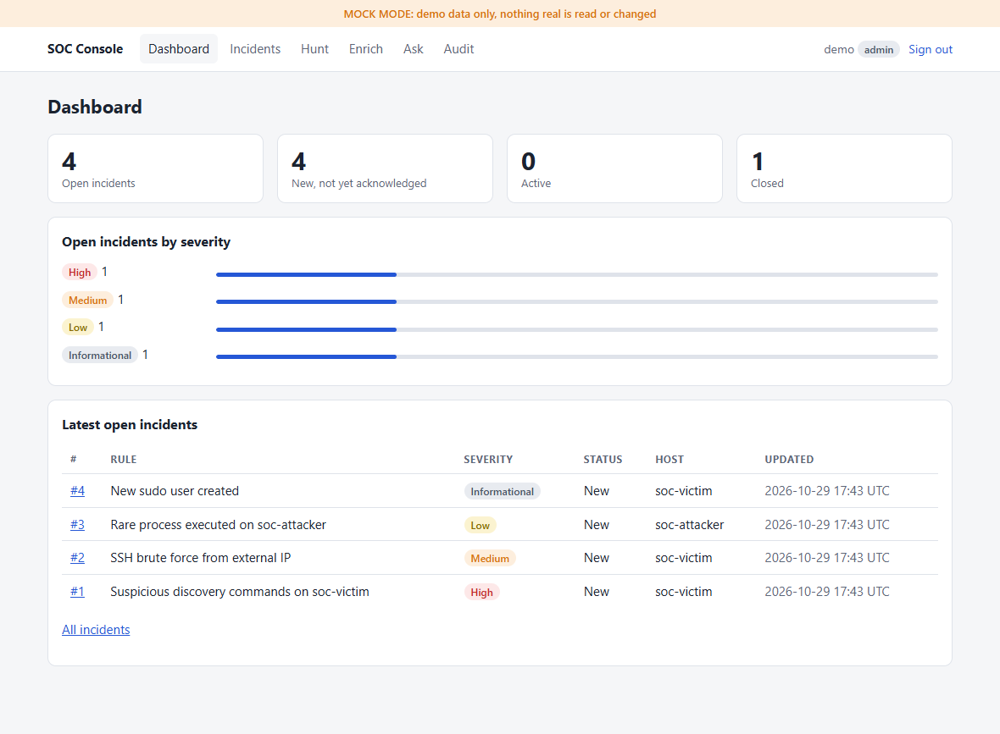

# Web console

A Flask app in [`soc_web/`](../soc_web/) that gives analysts the bot's triage workflow in a browser. It runs as its own process (`python -m soc_web`) and uses the same incident store, hunt templates, enrichment clients, AI assistant and audit log as the Discord bot.

## In plain words

The console is a web page where the SOC team can see security alerts ("incidents"), look into them, add notes, and close them once they are dealt with. It also has a question box (Ask) where anyone can ask the AI assistant about the SOC, and it only answers with what that person is allowed to know.

- **Everyone signs in** with their own account. Accounts are created by whoever runs the server, never on the web page.
- **What you can do depends on your level.** A *viewer* sees only totals and can ask the assistant for summaries. An *analyst* (read) can look at incidents, hostnames and addresses, run hunts and check an IP's reputation. *Triage* can also acknowledge, comment and close. *Admin* can also read the audit log, the record of who did what.
- **It cannot isolate a computer.** That stays in the Discord bot.
- **Everything people do is written to an audit log.**
- **Keep it on your own machine** (`http://127.0.0.1:8000`). It does not encrypt traffic itself, so using it from another computer needs a TLS proxy in front (see below).

The rest of this page is for the person setting it up.

> **Localhost only, unless a TLS proxy is in front.** The server speaks plain HTTP, so sign-in passwords and session cookies cross the network unencrypted on any address other than `127.0.0.1`. It binds to `127.0.0.1` by default. To reach it from another machine, put a TLS reverse proxy in front and keep `SOC_WEB_SECURE_COOKIES=true`. The console logs a warning if it is started on any other address.



## What it does

| Page | Minimum tier | What it does |
|---|---|---|
| Dashboard | VIEWER | Counts of incidents by status and open ones by severity; the latest open incidents for READ and above |
| Incidents, incident detail | READ | Filter by status and severity; the detail page has a timeline (alert raised, acknowledgements, comments, AI triage notes, IP enrichments, close) |
| Acknowledge, comment, close | TRIAGE | Close takes a second confirmation page, like the bot's confirm button |
| Enrich | READ | AbuseIPDB and VirusTotal verdict for an IP; optionally recorded as an incident comment |
| Hunt | READ | The predefined read-only SPL templates from `soc_bot/hunts.py`; input only fills a validated host or IP |
| Ask | VIEWER | The AI assistant, answering at the signed-in user's tier. Shows that level, example questions that fit it, and shows a refusal in its own amber panel |
| Audit | ADMIN | Filter by actor, action, outcome, channel (`web`, `discord`, `cli`), date range, or "denied only"; 50 per page, newest first. Incident entries link to the incident; `ai.ask` rows show the asker's level, tools used and whether anything was refused |

A strip under the header shows **mode** (mock or live), **Splunk** (reachable, unreachable, not configured), the **AI** backend (off, mock, claude_code) and when the **last alert** arrived. Splunk is checked in the background at most every 30 seconds, so a down Splunk never slows a page. "Last alert" is the newest incident in the shared database; it shows the bot's webhook has delivered something recently, not that the webhook is up.

Tiers are the bot's (`VIEWER < READ < TRIAGE < RESPONSE < ADMIN`). **There is no isolate or release button**: the console is built without the SSH client, and the assistant is given none either.

The assistant's per-tool clearance is shared code with the bot. The page-level tiers in the table are set in `soc_web/app.py` (`@needs(...)`) to match the bot's `@require(...)` commands, so if you change a command's tier in one place, change it in the other.

**How answers are shown.** On the Ask page the assistant's answer is laid out as a titled card of labelled rows (severity as a badge, "none" instead of `n/a`), a table when there are several rows (hunt results, incident lists), and a separate block for Confidence and Not checked. Free-form text from a real model stays as paragraphs. Below it, a box called **In plain words** shows 2 or 3 non-technical sentences. The assistant's prompt asks for that part after "Not checked:", and never on a refusal, so refusals stay word for word. The parsing lives in `soc_web/answers.py`. The prompt change is in `soc_bot/ai/prompt.py`, so Discord answers carry the same "In plain words:" paragraph, as plain text.

Pages a user's tier does not allow return 403, and the nav only shows what the account can open ([screenshot](screenshots/viewer-refused.png)).

## Run it

```powershell
pip install -r requirements.txt
python -c "import secrets; print(secrets.token_hex(32))"   # put the result in SOC_WEB_SECRET_KEY in .env
python -m soc_web user add alice --tier triage              # asks for the password twice
python -m soc_web                                           # http://127.0.0.1:8000
```

The console reads the same `.env` as the bot, but needs no Discord token, role IDs, channel IDs or `WEBHOOK_SECRET`. Point `DB_PATH` at the bot's incident database to see its incidents; alerts arrive through the bot's webhook, not the console.

Account commands: `user list`, `user passwd <name>`, `user tier <name> <tier>`, `user disable <name>`, `user enable <name>`. There is no sign-up page and no admin page for accounts, on purpose: accounts are made on the machine that runs the console.

Settings (all optional except the secret key; see `.env.example`):

| Variable | Default | Meaning |
|---|---|---|
| `SOC_WEB_SECRET_KEY` | none | Signs sessions. 32+ characters; the server refuses to start without it (mock mode makes a temporary one) |
| `SOC_WEB_HOST`, `SOC_WEB_PORT` | `127.0.0.1`, `8000` | Where it listens |
| `SOC_WEB_ALLOWED_HOSTS` | loopback + the bind address | Host names it answers to; any other `Host` header gets 400. Listening on `0.0.0.0` with no list accepts any, and logs a warning |
| `SOC_WEB_TRUSTED_PROXIES` | `0` | Number of TLS proxies in front. Above 0, `X-Forwarded-*` from them is believed |
| `SOC_WEB_SECURE_COOKIES` | `true` | Set `false` only for a plain-HTTP lab address |
| `SOC_WEB_SESSION_HOURS`, `SOC_WEB_MAX_FAILED_LOGINS`, `SOC_WEB_LOCKOUT_MINUTES` | `8`, `5`, `15` | Session length and lockout |
| `SOC_WEB_USERS_DB` | `web_users.db` | Accounts (git-ignored) |

**Demo:** with `SOC_BOT_MOCK=true` the console uses in-memory fake data and, if there are no accounts, creates `demo` (ADMIN) and prints its random password once.

## Security notes

- **Passwords** are stored as scrypt hashes, at least 12 characters. After 5 failed sign-ins (configurable) an account is locked for 15 minutes, and each address may try 20 sign-ins per 5 minutes. A wrong username and a wrong password give the same answer and take about the same time.
- **Sessions** are signed cookies: `HttpOnly`, `SameSite=Lax`, `Secure` unless `SOC_WEB_SECURE_COOKIES=false`, and renewed at every sign-in. The user's tier is read from the database on every request, so disabling an account or lowering a tier applies at once. Each account has a session counter carried in the cookie: signing out, changing the password or disabling the account bumps it, so a copied cookie stops working at once instead of at its expiry. (Signing out therefore ends that user's sessions in every browser.)
- **Host header:** requests whose `Host` is not in the allowed list are refused (see settings).
- **CSRF:** every POST needs a per-session token.
- **Content Security Policy** allows no scripts at all and no inline styles, and the pages contain none. Alert text, comments and Splunk rows are untrusted, and Jinja escapes them. An alert link is only shown as a link if it is `http` or `https`.
- **Account changes** made with `python -m soc_web user ...` are written to the audit log as `account.create`, `account.passwd`, `account.tier`, `account.disable`, `account.enable` (channel `cli`, actor `cli:<operating-system user>`); failed sign-ins and lockouts appear as `auth.login` denied.
- **Secrets in free text** (API keys, tokens, JWTs, `password=...`, long hex strings) are replaced by `[redacted]` before anything is written to the audit log or sent to Splunk. This is a safety net, not a guarantee.
- **Audit:** every incident list or detail view, change, hunt, enrichment, question and audit view is written to the audit log with `channel: web` and the client address, and forwarded to Splunk HEC when that is configured. Failed sign-ins are logged with the typed username but never the password.
- **Comment authors** are stored as `name@web`, so a console account cannot pass itself off as a Discord user of the same name.

## Before using it beyond localhost

- The server speaks plain HTTP. For any other address put a TLS reverse proxy in front, and keep `SOC_WEB_SECURE_COOKIES=true`. Set `SOC_WEB_TRUSTED_PROXIES=1` (the number of proxies) so the sign-in limit and the audit log see the real client address; leave it at `0` with no proxy, because then anyone could forge `X-Forwarded-For`. The console warns at startup when it listens beyond loopback with `SOC_WEB_TRUSTED_PROXIES=0`.
- **Which audit copy is authoritative.** The file is a convenience copy: anyone with access to the server can edit it, and it has no tamper evidence. With `SPLUNK_HEC_URL` set, every entry is also sent to Splunk (`index=soc_audit`), and **that copy is the authoritative one**. The Audit page says which situation applies.
- **Audit log growth.** The log is never rotated by the code: two processes append to one file, and renaming it under them can lose lines (and fails outright on Windows). On the Linux VM rotate it with `logrotate` using `copytruncate`; the Audit page reads only the current file.
- **Shared audit log.** The bot and the console append whole lines to the same `AUDIT_LOG_PATH`, each from its own process. That is fine for this lab. If they ever run as separate services (different machines, containers or accounts), give each its own file, or use the copy in Splunk (`index=soc_audit`, set `SPLUNK_HEC_URL` and `SPLUNK_HEC_TOKEN`) as the combined record. The Audit page reads only the file it is pointed at.
- Closing an incident is the one change that cannot be undone from the console.

## Layout

```
soc_web/
├── __main__.py      # server and `user` commands
├── app.py           # routes and the permission check on each
├── config.py        # SOC_WEB_* settings
├── runtime.py       # background event loop and the shared backends
├── security.py      # CSRF, sign-in throttle, response headers
├── status.py        # background Splunk probe for the status strip
├── answers.py       # lays the assistant's answer out as cards and tables
├── users.py         # accounts: hashing, tiers, lockout
├── templates/       # Jinja pages (no JavaScript)
└── static/
    ├── style.css    # the space-UI theme: pure CSS, including the planet
    └── fonts/       # Orbitron and Exo 2, self-hosted, with their SIL Open Font License files
```

## The look

A retro space-UI theme: cream, teal and orange on charcoal, ridged menu tabs for incidents with a coloured severity marker, and a planet on the dashboard with one orbiting moon for each severity that still has open incidents.

It is cosmetic. Tier names are shown as ranks (Cadet, Scout, Pilot, Guardian, Commander for VIEWER up to ADMIN), the threat level comes from the worst severity still open, and severities get star ratings. None of it changes what a tier may do.

It is built to fit the security policy: no JavaScript, no inline styles and no outside fonts, so the policy still reads `default-src 'none'` with `style-src 'self'` and `font-src 'self'`. The planet is drawn in CSS. Orbits stop turning when the browser asks for reduced motion.

## Known limits

- **The audit file has no tamper evidence** (no hash chain); the Splunk copy is the one to trust (see above). Searching reads the whole file, which is fine for a lab and slow for a log of many gigabytes.
- **Acknowledgements in the timeline** come from the audit log, because the incident store keeps no status history. Acknowledgements from Discord and from the console both appear, but one made before the audit log existed, or after it was deleted or rotated away, is missing.
- **The sign-in rate limit is kept in memory**, so it resets when the server restarts. Account lockouts are stored and survive restarts.
- **One process.** The console runs four worker threads in one process; it is built for a small team, not for many simultaneous users.
- **Real Splunk is only lightly exercised.** Timeouts show an error message and a down Splunk shows as "unreachable", but very large result sets are cut to 100 rows on the Hunt page and have not been load-tested.
- There is no separate help page: what each tier may do is in this document and on the Ask page.
